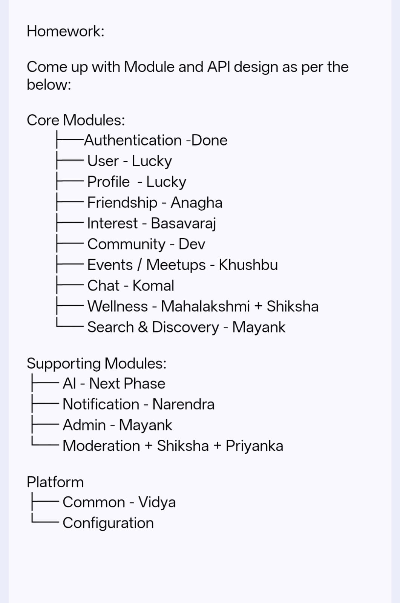

# BuddyAdda - Module & API Design

## Core Modules

| Module No. | Module Name | Status | Document |
|------------|-------------|--------|----------|
| M01 | Authentication | ✅ | [m01_authentication.md](m01_authentication.md) |
| M02 | User | ✅ | [m02_user.md](m02_user.md) |
| M03 | Friendship | ✅ | [m03_friendship.md](m03_friendship.md) |
| M04 | Interest | 🔄 | [m05_interest.md](m05_interest.md) |
| M05 | Community | 🔄 | [m06_community.md](m06_community.md) |
| M06 | Events / Meetups | 🔄 | [m06_community.md](m06_community.md#3-events-module) |
| M07 | Chat | 🔄 | [m08_chat.md](m08_chat.md) |
| M08 | Wellness | 🔄 | [m09_wellness.md](m09_wellness.md) |
| M09 | Search & Discovery | 🔄 | [m10_search_discovery.md](m10_search_discovery.md) |

---

## Supporting Modules

| Module No. | Module Name | Status | Document |
|------------|-------------|--------|----------|
| M10 | AI | ❌ | - |
| M11 | Notification | ❌ | - |
| M12 | Admin | ❌ | - |
| M13 | Moderation & Safety | 🔄 | [m14_moderation_n_safety.md](m14_moderation_n_safety.md) |

---

## Platform

| Module No. | Component | Status | Document |
|------------|-----------|--------|----------|
| M14 | Common | 🔄 | [m15_common_config.md](m15_common_config.md) |
| M15 | Configuration | ❌ | - |

---

## Status Legend

- ✅ **Done** - Module completed and reviewed
- 🔄 **To-Review** - Documentation exists, needs review
- ❌ **Not Started** - No documentation file yet
